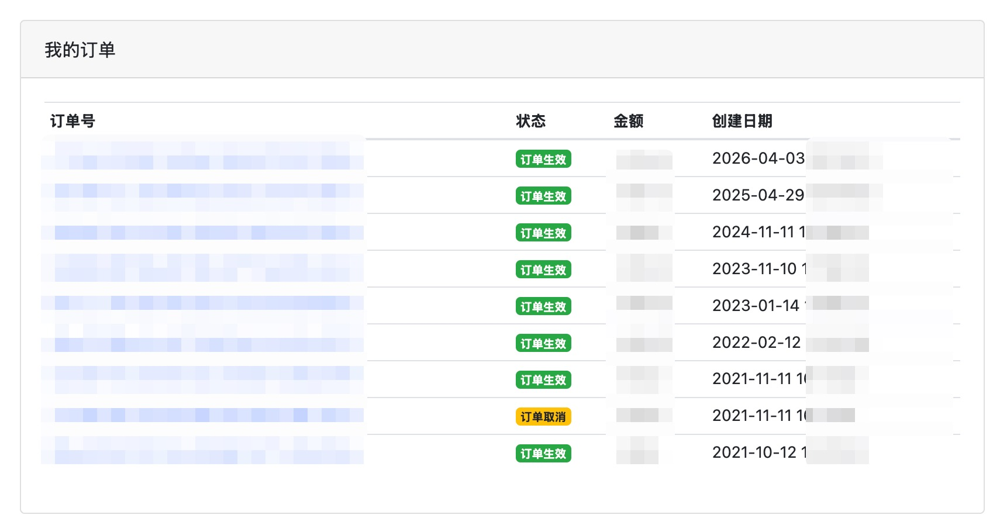
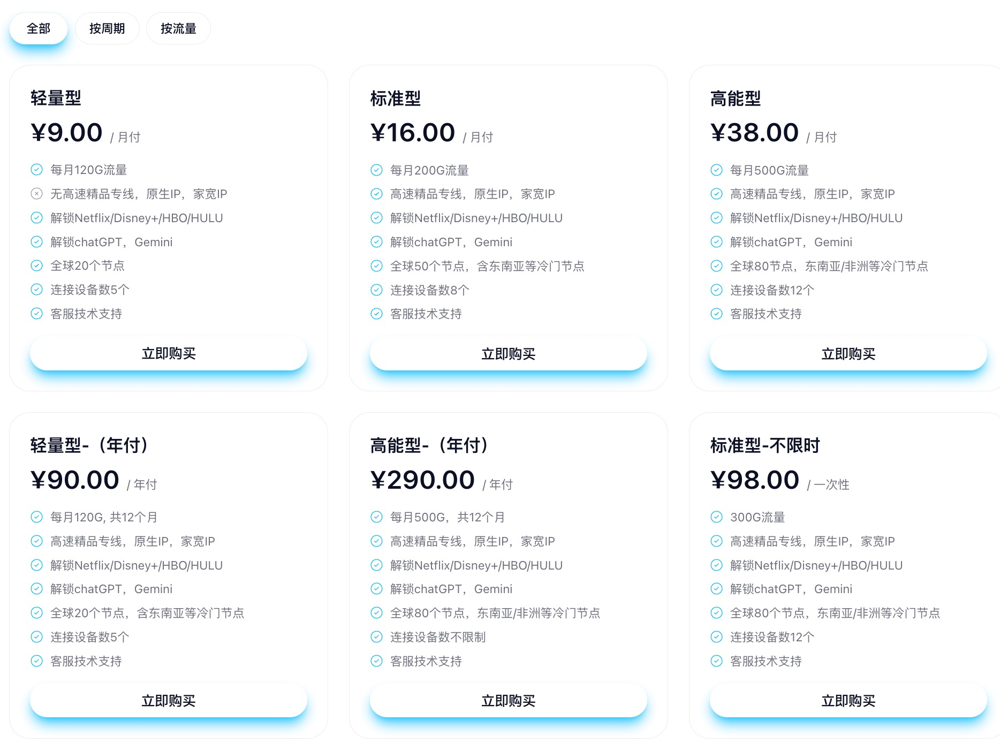
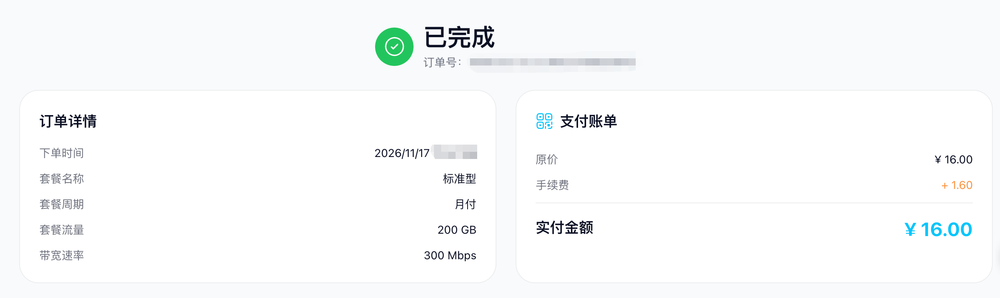
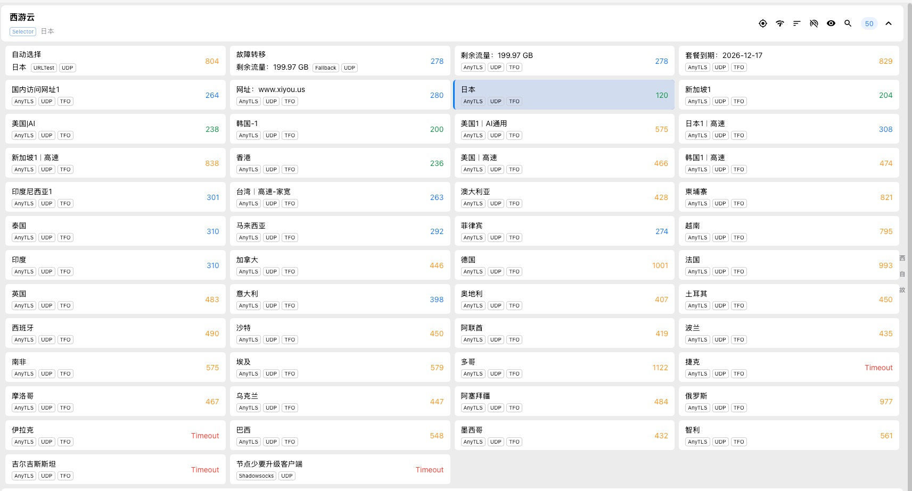
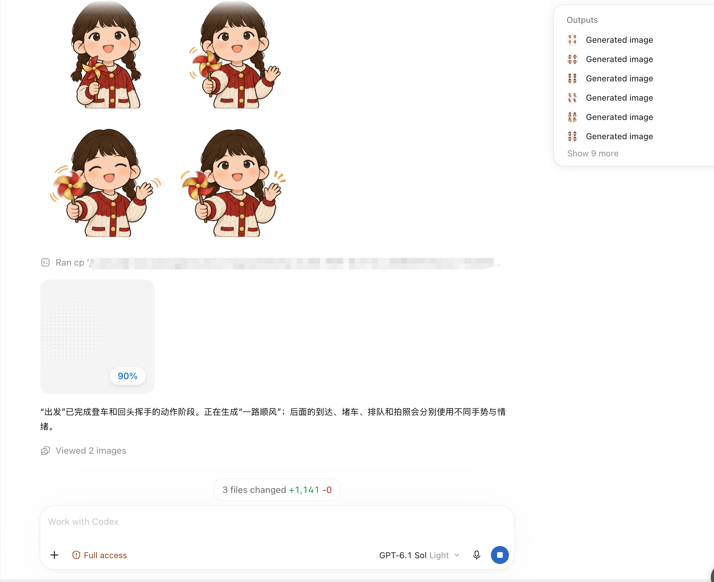

> 仅是个人经验，不对这些服务商进行推荐。

2021 年 10 月 12 日，我买了 AgentNEO 服务，到现在 2026 年，正好是将近五年，前几年一直都比较稳定，没有什么问题，哪怕是国庆节这种节假日也非常稳定。但是最近一年，可能是因为 AI 的发展导致使用者和流量激增，它的节点经常不稳定。

周六周日速度很快很稳定，但周六周日不干活，不是工作日谁会用它呢？平时都是周一到周五使用，但周一到周五大家都用，导致它的节点很容易挂掉。

今天打开 ChatGPT 告诉我，不能使用，看一下梯子的节点，全部挂了，一个能用的都没有，只剩一两个，通过延迟测速，偶尔有效偶尔无效，这还干个屁活，纯粹浪费我时间。

以前节点不能用，作者都会在推特或者 Telegram 上发消息说哪里坏了，多久能恢复。现在连消息都没有了，感觉他们就不维护了似的。

找来找去，找到了一个价格差不多的——西游云，最便宜的九块钱一个月 120G 流量，没有高速精品专线原生 IP 家宽 IP，但是 1 个月 16 元 200 G 流量的就有这个专线，加上 10% 的服务费是 17.6 元，我就买了一个月试试。

付款后测试了节点速度，目前看来节点非常好，只有几个是没有连通的，剩下的全部都是绿色的或者蓝色的，只要不是红色的表示速度非常快。

用 ChatGPT 试了一下生成表情包，现在就不会失败了。之前用 AgentNEO 老是生成中就会断掉连接遇到 `Reconnecting stream disconnected before completion: IO error: Broken pipe (os error 32)` 错误，现在没有这个重新连接错误了，生成图片刷刷的，但是后续有没有这个速度和稳定性就不知道了，当个备用吧。

如果你也想试试西游云，可以先购买一个月，试试好不好用，点击这个链接进行注册购买： https://e.xiyou666.xyz/?code=CHpwqczY
